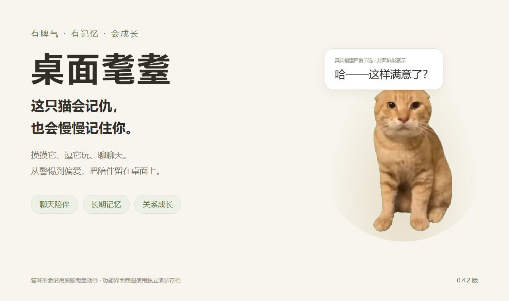
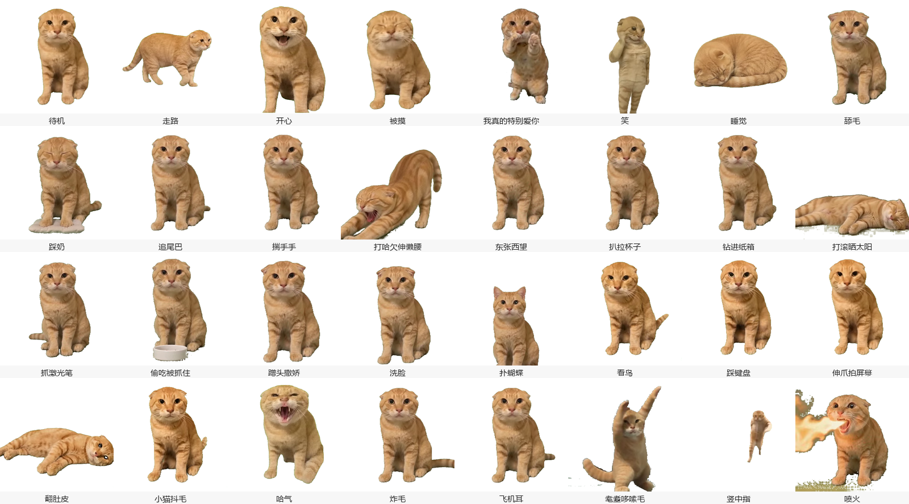
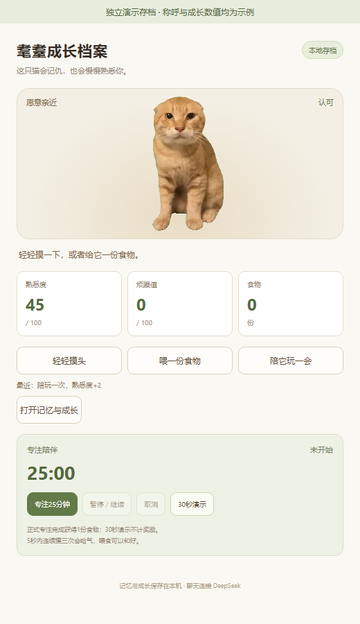
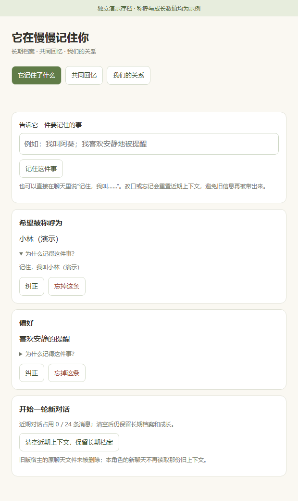
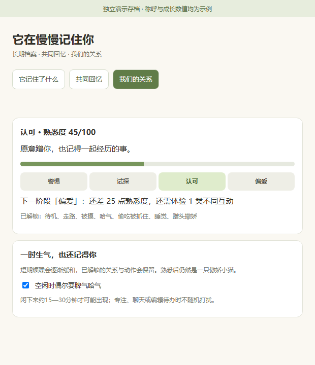
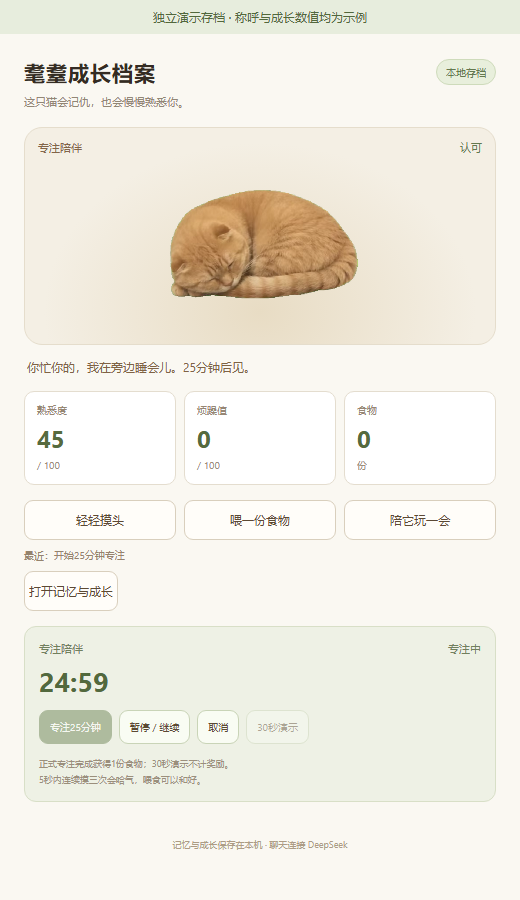

# 桌面耄耋



**这只猫会记仇，也会慢慢记住你。**

在电脑桌面养一只傲娇小橘猫：摸摸它、逗它玩，连续戳它会哈气；和它聊天，它会记住你希望被怎么称呼。陪伴增加熟悉度，从警惕到偏爱，逐步解锁蹭头、翻肚皮等动作。它还能陪你专注，在待办到点时提醒你。

当前为 **0.4.2 版**，已在本机运行验证。提供源码与安装说明，运行需要先安装宿主程序。

**从这里开始：[安装与运行](#安装) · [测试与验证](docs/验证结果.md) · [角色系统设计](角色系统设计.md)**

本作品基于[原版耄耋动画包](https://github.com/Edwardpch/maodie-pet)和[桌宠运行时](https://github.com/PC2005-cloud/dsh-pet)，新增聊天人设、长期记忆、关系成长、专注陪伴与待办提醒。技术插件标识为 `maodie-life`，对外介绍统一使用「桌面耄耋」。

封面使用原版猫咪动画和真实模型回复节选排版，属于项目介绍图。素材来源、修改范围与许可见 [第三方说明](THIRD_PARTY_NOTICES.md)。

## 看看它能做什么

### 原来的32个动作都保留着



这是原版耄耋的动作总览，点击图片可以查看大图。**32个原始动画全部保留**，新增的聊天、记忆和养成功能没有删除它们。

- **日常小动作**：舔毛、踩奶、追尾巴、揣手手、打哈欠伸懒腰、东张西望、扒拉杯子、钻进纸箱、打滚晒太阳、抓激光笔、偷吃被抓住、洗脸、扑蝴蝶、看鸟、踩键盘、伸爪拍屏幕、小猫抖毛。
- **互动与亲近**：开心、被摸、笑、蹭头撒娇、翻肚皮、我真的特别爱你。
- **有脾气的时候**：哈气、炸毛、飞机耳、耄耋哆嗦毛、竖中指、喷火。
- **待机与陪伴**：待机、走路、睡觉。

[查看全部原始动画文件](vendor/maodie-pet/pets/maodie/maodie-animation) · [查看原版动作说明与来源](vendor/maodie-pet/README.md)

桌宠里的手动动作入口仍在「右键猫 → 原版动作与设置」。养成阶段控制部分动作的自动解锁与触发；素材完整保留，不代表所有动作都会立刻自动出现。

### 新增的记忆与养成功能

下面四张图由本版真实界面渲染，使用独立演示存档；称呼和熟悉度是示例，不代表真实用户记录或多日养成测试。截图没有包含其他桌面窗口。[图片来源与生成方式](docs/images/图片说明.md)

**摸摸头、喂食、陪玩：互动和成长都看得见。**



**它记住了什么，可以查看依据，也能纠正和忘掉。**



**从警惕到偏爱：查看当前关系、下一阶段条件和已解锁动作。**



**你专注，它睡觉：开始计时后，小猫就在旁边趴下来。**



## 玩法

- 左键摸猫：熟悉度增加，30 秒内重复摸不重复加熟悉度。
- 5 秒内摸三次：立刻哈气，增加烦躁，短时间内不追鼠标。
- 喂食：消耗一份食物，消除记仇、增加熟悉度。初始有三份食物。
- 陪玩：选择菜单后慢慢移动鼠标，猫会短距离追逐；不生气时，光标在附近缓慢移动也可能引起它注意。陪玩增加 2 点熟悉度，每分钟最多奖励一次，猫旁边显示加分提示。
- 专注：25 分钟内猫趴下睡觉，完成后奖励一份食物。支持暂停、继续、取消和重开恢复。
- 成长：警惕（0—19）→试探（20—39）→认可（40—69）→偏爱（70—100）；偏爱还需经历三类互动。认可解锁蹭头，偏爱解锁翻肚皮。关系改变会影响每轮聊天的语气及靠近、欢迎等行为；已解锁的阶段和动作不因暂时生气而消失。旧存档保留原有分数及动作。
- 聊天：右键猫 →「和耄耋聊天」，输入后回车发送。使用已登录的本机 DeepSeek，按傲娇小猫人设真实生成回复，结合当前关系、心情和记忆，保留最近 12 轮。成功收到回复后增加 1 点熟悉度，每 30 秒最多奖励一次；只打开窗口、请求失败或重复回调不加分。加分提示独立显示，不覆盖回复。
- 长期记忆：说「记住，我叫阿葵」「以后叫我小林」「忘掉我的称呼」。右键猫 →「记忆与成长」，能查看原话依据、纠正、忘记、清空近期上下文；长期档案关掉重开仍在。记忆指令由程序确认保存，普通聊天由模型生成，两者在接口的 mode 字段中区分。无称呼记录时的直接询问使用明确的程序回答，避免模型编造旧名字。
- 共同回忆：第一次喂食、陪玩、聊天、和好、完成正式专注或待办，以及关系变化由实际程序事件记录。勾选待办代表用户自报完成。
- 偶尔哈气：聊天中的哈气动作有轮次冷却，用户倾诉疲惫时抑制哈气；空闲约 15—30 分钟可能耍一次脾气，可在「我们的关系」中关闭。专注、聊天和编辑待办时不随机打扰。
- 阅读：聊天输入与回复使用微软雅黑等系统字体，正文 18px、1.75 倍行距，输入框宽 320px；移除原版装饰字体与回复字号缩小规则。
- 待办：右键猫 →「待办与提醒」，填写内容，选择日期、小时与分钟后添加；完成后勾选，可单条删除。
- 到点提醒：桌宠运行时每秒检查一次，由猫弹气泡提醒；显示后保存确认，重开不重复播报。关闭期间到期的事项会在重开后补提醒。正在编辑待办时会等面板关闭后显示，避免打断输入。

直接右键猫，会出现「和耄耋聊天」「待办与提醒」「记忆与成长」「摸摸头」「喂耄耋 · 剩余 N 份」「逗猫玩」「陪我专注 25 分钟」「打开养成面板」。开始专注后，菜单自动变为暂停、继续和结束。原版动作保留在「原版动作与设置」中。

30 秒演示明确标记，不发食物、不计入正式专注次数。正式专注是用户手动开启的计时器，不声称识别你是否真的在工作。

## 实现与存档

右键猫 →「打开养成面板」可以打开成长档案，查看熟悉度、烦躁和食物。日常互动从猫身上操作，面板提供详细状态和辅助按钮，共用同一份实时状态与存档。

`src/model.mjs` 为独立状态机，`store.mjs` 原子保存成长记录，`controller.mjs` 提供只监听本机的养成服务与右键菜单，`life-client.js` 将行为接到现有桌宠动画上。

存档：`%USERPROFILE%\.dsh\maodie-life\state.json`。运行端口信息：同目录 `runtime.json`。

鼠标位置只用于即时计算距离与移动方向，不写入成长存档。聊天消息通过宿主已有的 DeepSeek 接口发送；近期上下文和长期档案由本插件的 `%USERPROFILE%\.dsh\maodie-life\memory.json` 保存。改口、忘记会清理本角色近期上下文，避免旧信息再次带入。原宿主的旧聊天文件未删除，新角色不读取它；本地忘记也不代表删除模型服务方记录。待办保存在同目录 `todos.json`，提醒不依赖模型联网。

长期档案首版只处理明确的「记住」指令和简单的姓名自述，不自动从所有聊天推断。只有用户原话或手动编辑能写入档案；模型返回的建议不会直接修改档案、成长数值或任务。共同回忆只使用已有实际事件，不补造历史日期。当前角色聊天仅支持文字，已隐藏原版截图、上传与语音入口。

聊天中说「提醒我」不会自行创建定时任务；目前请通过「待办与提醒」明确添加。人设提示也要求模型不要声称已经创建未执行的提醒。

## 安装

需要 Windows、Node.js 22+，并先安装 DeepSeek Harness。本机验证宿主版本为 `0.2.1-rc.3`，兼容目标为 `dsh-pet 0.4.5`。这不是独立免安装程序。

```powershell
git clone https://github.com/CKKKK101/maodie-companion.git
cd maodie-companion

# 默认安装路径；如果你的安装位置不同，请修改此行。
$dshCmd = "$env:LOCALAPPDATA\Programs\DeepSeek Harness\resources\runtime\cli\bin\dsh.cmd"
& $dshCmd plugin --profile desktop add dsh-pet@0.4.5

# 顺序安装本仓库附带的修订版素材包，再安装角色扩展。
$sourcePath = (Get-Location).Path.Replace('\', '/')
& $dshCmd plugin --profile desktop add "file:$sourcePath/vendor/maodie-pet"
& $dshCmd plugin --profile desktop add "file:$sourcePath"
```

打开或重启 DeepSeek Harness，猫显示在桌面后右键互动。若找不到 `dsh.cmd`，请先确认宿主已安装，或使用其实际 CLI 路径。仓库自带固定版本素材与本地修订，不需要另找原工作区文件。

聊天需要在宿主登录可用模型，并为耄耋选择模型。本机使用 DeepSeek Account / `deepseek-v4-pro`；如果模型不同，请在原版宠物设置中选择可用模型。没有可用模型时聊天会明确失败，本地养成与待办仍可使用。

安装后插件会为现有桌面运行时增加三个有标记的扩展点，并增加一个自有客户端文件；原文件在 `%USERPROFILE%\.dsh\maodie-life\host-backups` 留存备份。扩展点找不到时明确报错，不盲目修改其他版本。补丁面向本机已验证的 dsh-pet 0.4.5。

本机聊天已选择 DeepSeek Account 的 `deepseek-v4-pro`。新机器需在宿主登录并选择可用模型；本源码不包含账号或密钥。角色使用宿主 LLM 接口、独立 UUID 会话与 1024 输出上限。原版 dsh-pet 调用的兼容包装仅处理其固定会话标识，卸载恢复原方法。本轮 Flash 曾返回服务繁忙，Pro 完成了真实聊天、跨近期上下文及插件重启后的记忆测试；不保证远端模型服务始终可用。

启动桌宠后，双击本目录的 `打开养成面板.cmd`；需要本机有 Node.js 22 或更高版本。也可使用猫的右键菜单打开。此目录是插件源码，并非脱离宿主的独立免安装运行包。

## 验证

```text
node --test tests/*.test.mjs
```

目前 24 项自动测试通过，覆盖养成、专注、待办、提醒、存档、兼容补丁、猫菜单、聊天奖励，以及长期记忆的新增/纠正/忘记/并发修改、关系迁移、解锁保留、哈气冷却和人设上下文。实机结果见 [验证记录](docs/验证结果.md)，不以单元测试代替鼠标交互验收。

当前未完成：自动提炼记忆候选、关系纪念卡导出、独立阶段演示存档。高阶段与 15—30 分钟空闲行为主要通过可控时间测试验证，未声称完成多日实机养成。尚未在另一台干净 Windows 电脑安装验证。

原始桌宠复现记录见 [复现说明](复现说明.md) 和 [上游本地补丁说明](vendor/maodie-pet/REPRODUCTION-PATCH.md)。原始 32 个动画的测试结果属于养成扩展安装之前的基线。

## 素材对应

待机、走路、被摸、哈气、睡觉沿用原动作。喂食暂用原包的「偷吃被抓住」，没有另造一段进食动画。注视表现为转向光标，未实现眼球骨骼跟踪。

原始项目作者及许可保持独立，养成扩展代码采用 MIT 许可。
