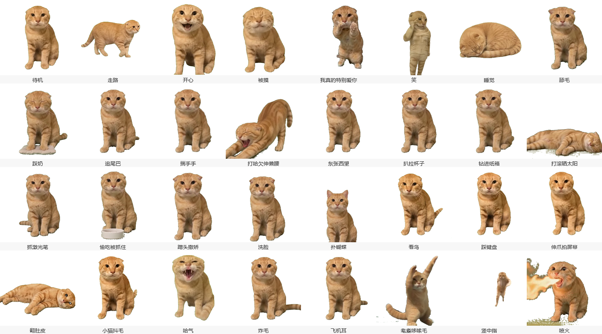
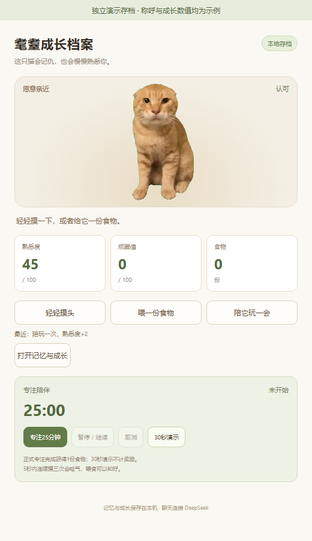
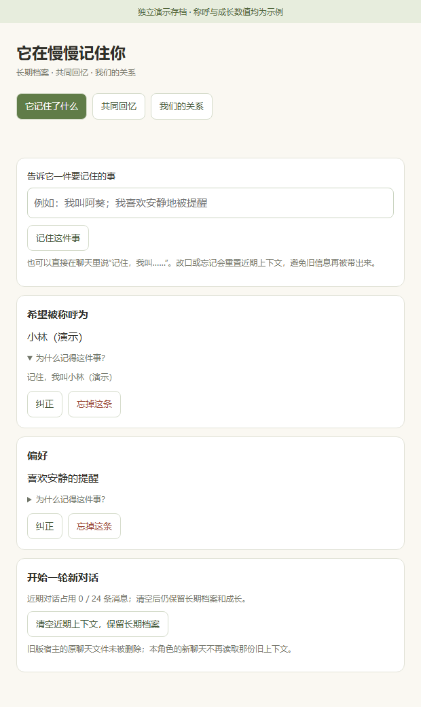
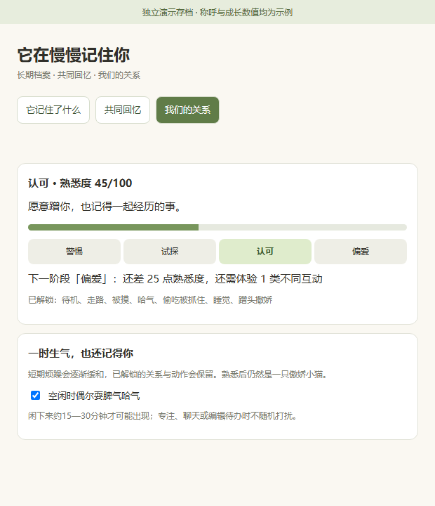
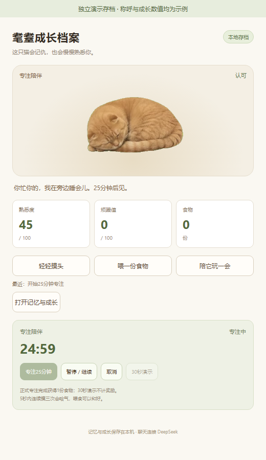

# 我在电脑里养了只耄耋，摸它三下，它开始记仇了

写东西卡住时，我顺手戳了戳桌面上的小橘猫。摸一下，它有回应；五秒内连戳三次，它直接哈气：“别一直戳！我记住你了。”给它一份吃的，它又不情愿地和好了。

我想做的，就是这种有来有回的陪伴。它能聊天，能记住你的称呼，还会随着摸头、陪玩和交流慢慢熟悉你。你开始专注，它就在旁边睡觉；待办到点，再由它提醒你。



*猫咪动画来自开源耄耋项目。下方四张功能截图使用独立演示存档，称呼与45分熟悉度为示例。*

## 第一步：把猫请到桌面上

打开[项目下载页](https://github.com/CKKKK101/maodie-companion/releases/tag/v0.4.2)，下载笔试完整提交包并解压。首次使用需要一台Windows电脑，先安装DeepSeek Harness和Node.js 22或更高版本。聊天还需要在宿主里登录可用模型；本机使用的是DeepSeek账号下的Pro模型。

接下来，在解压后的项目文件夹空白处右键，选择“在终端中打开”，使用PowerShell执行下面几行。第一行是宿主默认安装位置，如果你安装到了别处，需要换成自己的路径。

```powershell
$dshCmd = "$env:LOCALAPPDATA\Programs\DeepSeek Harness\resources\runtime\cli\bin\dsh.cmd"
& $dshCmd plugin --profile desktop add dsh-pet@0.4.5
$sourcePath = (Get-Location).Path.Replace('\', '/')
& $dshCmd plugin --profile desktop add "file:$sourcePath/vendor/maodie-pet"
& $dshCmd plugin --profile desktop add "file:$sourcePath"
```

这几行依次安装桌宠运行时、猫咪素材和角色扩展。完成后打开或重启宿主，猫会出现在桌面。这里提供的是源码版，需要依赖宿主运行；启动路径与模型配置也可以对照[安装说明](../README.md#安装)。

## 第二步：先摸摸它，再试着惹它一下

左键点猫是摸头，右键打开互动菜单。先轻轻点一下，再试试五秒内连续点三下：猫会哈气，进入短暂记仇状态，这时可能不愿意陪玩。

右键选择喂食，会消耗一份食物、缓和烦躁；选择“逗猫玩”后，慢慢移动附近的鼠标，它会短距离追逐。初始有三份食物，正式专注完成后可以再获得一份。

想看清互动变化，可以打开“养成面板”。熟悉度、烦躁和食物数量都在这里。猫有舔毛、踩奶、追尾巴、打滚等32种动作，更多动作可以在“原版动作与设置”中选择。



## 第三步：和这只嘴硬的小猫聊聊

右键猫，选择“和耄耋聊天”，输入文字后按回车发送。你可以问：“你这只嘴硬的小猫，要不要轻轻哈我一下？”本机实测收到的回复是：“哈——这样满意了？”普通聊天由模型实时生成，每次表达可能不同。

它的设定是傲娇小橘猫：爱面子、嘴硬心软，偶尔哈气；你认真说累了或难过时，会优先安慰。成功聊天可以增加熟悉度，但有冷却时间，反复开关聊天框不会加分。陪玩也能加分，适合边工作边偶尔互动一下。

## 第四步：让它记住你，也允许它忘记

直接告诉它：“记住，我叫小林。”然后右键打开“记忆与成长”，在“它记住了什么”里，会看到称呼卡片。展开依据，能看到这条记忆来自哪句原话。

想改称呼，就说“以后叫我阿葵”；不想让它记着，就说“忘掉我的称呼”。也可以直接纠正或删除卡片。明确的记忆指令由程序保存，普通聊天由模型表达，模型自己的猜测不会直接写成你的档案。

你还可以清空近期对话，再问它希望怎么称呼你。这能直观看到近期聊天和长期档案的区别。本机已测试改名、清空近期上下文和插件重启后的称呼回忆。



## 第五步：从“人类”变成它熟悉的人

打开“我们的关系”，可以看到警惕、试探、认可、偏爱四个阶段。熟悉度达到40进入认可，解锁蹭头；达到70并经历三类不同互动，才能进入偏爱、解锁翻肚皮。

关系阶段会进入每轮聊天的人设，也会影响主动靠近等行为。临时生气不会抹掉已经解锁的成长。“共同回忆”记录实际发生的第一次喂食、陪玩等事件，让相处有迹可循。



## 第六步：你忙你的，它在旁边睡会儿

右键选择“陪我专注25分钟”，猫会趴下睡觉，计时支持暂停和继续。结束后获得一份食物，正好可以投喂它。想快速看效果，可以使用30秒演示；演示不会发放正式奖励。

还有必须记住的小事？打开“待办与提醒”，填写事项和到点时间。桌宠运行时会弹出提醒，关闭期间错过的事项会在重开后补提醒。目前需要在面板明确添加，在聊天里说“提醒我”还不会直接建立待办。



这版最值得试的，是一句话、一次摸头之后，猫真的会给出回应。当前已完成本机互动和记忆验证，高阶段及部分时序使用可控状态测试；多日养成体验还需要时间打磨。你可以先从告诉它名字开始，看看这只爱哈气的猫，会怎样和你慢慢熟起来。
